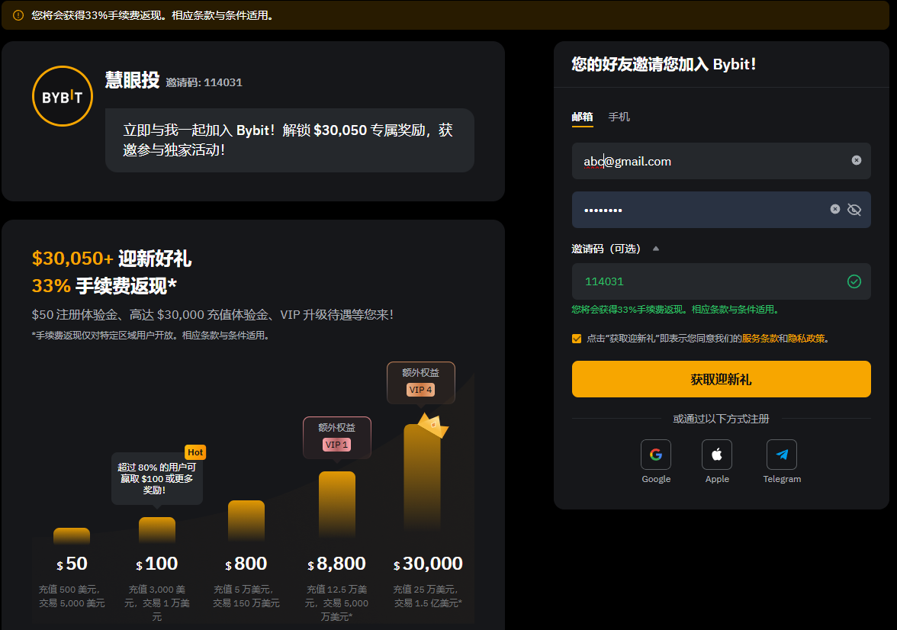

# 2026 前几大交易所返佣情况

|交易所 |返佣比例 |优惠链接 | 邀请码  | 
| --- | --- | --- | --- | 
|BN| 20% |https://www.yiqnyfbhanzj.com/register?ref=X5EX8CVJ |X5EX8CVJ|
|OKX|20%  |https://www.hnrvqbxkptm.org/join/69659565|69659565|
|Bybit |33% |https://www.bytack.com/zh-MY/sign-up?affiliate_id=114031|114031|
|Bitget|50%|https://partner.bitget.ninja/bg/351xdta3|DDDD0000|
| Gate|60%|https://www.gatewebsite.com/share/DDDDFFFF |DDDDFFFF|
| BIT|美股0佣金|https://invest.matrixport.com/newRegister/cn?invite_code=9YZ5GD |9YZ5GD|

如交易量大，可加小助手私聊，获取更多优惠。

[**2025加密货币衍生品市场年度报告** ](https://mp.weixin.qq.com/s/qgLibYeTok20V1bN30NxRA)

https://mp.weixin.qq.com/s/qgLibYeTok20V1bN30NxRA

截至2025年，全球主流加密货币交易所中，**币安（Binance）、欧易（OKX）、Bybit、Bitget 和 Gate.io** 是用户活跃度高、功能全面且各具特色的头部平台。以下从 **交易量与流动性、手续费结构、产品特色、安全性与合规性、目标用户群体** 五个维度进行对比分析：

---

## 一、综合概览对比表

| 项目 | 币安（Binance） | OKX（欧易） | Bybit | Bitget | Gate.io |
|------|------------------|--------------|--------|---------|----------|
| **日均交易量（2025）** | >500亿美元（全球第1） | ~30亿美元（第5） | >200亿美元（衍生品为主） | ~40亿美元（第6） | ~35亿美元（第8） |
| **现货手续费（Taker）** | 0.1%（BNB支付0.075%） | 0.1%（OKB支付更低） | 0.1% | 0.1% | 0.2%（VIP可低至0.05%） |
| **衍生品杠杆** | 最高125x | 最高100x | 最高100x | 最高125x | 最高100x |
| **支持币种数量** | 500+ | 400+ | 300+ | 500+ | **3800+**（最多） |
| **合规性** | 持多国牌照，美国受限 | 全球合规布局，美国受限 | 新加坡/迪拜牌照，欧美谨慎 | 新兴市场强，监管较宽松 | 开曼注册，新兴市场活跃 |
| **特色功能** | BSC生态、Launchpad、NFT、教育学院 | Web3钱包、AI交易助手、跨链桥 | 衍生品API快、跟单交易 | **社交跟单交易**、空投活动多 | **小币种天堂**、Launchpad快 |
| **适合人群** | 机构/大资金/全能型用户 | 中文用户/Web3探索者 | 合约高频交易者 | 社交型/新手合约玩家 | Altcoin猎手/早期项目投资者 |

---

## 二、详细特色分析

### 1. **币安（Binance）—— 全能霸主**
- **优势**：
  - 全球最大流动性，滑点极低；
  - 生态完整：BSC公链、Launchpad、NFT市场、Binance Pay；
  - 手续费最低（尤其用BNB抵扣）；
  - CoinGecko信任分9.9/10。
- **劣势**：
  - 功能繁杂，新手易“迷失”；
  - 美国用户需用Binance.US（功能阉割）；
  - 提现费用较高。

> ✅ **推荐给**：追求极致流动性和全栈服务的用户。

---

### 2. **OKX（欧易）—— Web3与体验平衡者**
- **优势**：
  - 中文界面友好，操作逻辑符合国人习惯；
  - 内置**非托管Web3钱包**，无缝切换CEX/DEX；
  - AI交易助手、量化工具、跨链资产互换（OKX Chain）；
  - 安全记录优秀，从未被黑。
- **劣势**：
  - 小币种流动性不如Gate；
  - 美国IP受限。

> ✅ **推荐给**：想尝试DeFi又依赖中心化便利的中文用户。

---

### 3. **Bybit —— 衍生品性能之王**
- **优势**：
  - **API响应速度行业领先**，适合程序化/高频交易；
  - 衍生品日交易量超200亿，永续合约深度好；
  - 跟单交易、模拟盘功能完善；
  - 界面简洁，学习成本低。
- **劣势**：
  - 现货币种较少；
  - 合规布局弱于币安/OKX。

> ✅ **推荐给**：专注合约交易的专业或进阶玩家。

---

### 4. **Bitget —— 社交交易先锋**
- **优势**：
  - **复制交易（Copy Trading）功能最强**，可一键跟单高手；
  - 衍生品杠杆高达125x，活动奖励丰富（空投、竞赛）；
  - 用户增长快，尤其在亚洲和拉美；
  - 1亿美元用户保护基金。
- **劣势**：
  - 小币种覆盖不如Gate；
  - 合规性相对较弱。

> ✅ **推荐给**：新手或希望“社交化投资”的用户。

---

### 5. **Gate.io（芝麻开门）—— Altcoin宝藏库**
- **优势**：
  - **支持超3800种代币**，新币上线速度极快；
  - 不强制KYC，隐私友好；
  - Launchpad项目多，适合早期投资；
  - 支持支付宝等法币通道（部分区域）。
- **劣势**：
  - 主流币流动性一般；
  - 界面信息过载，体验稍杂乱；
  - 高级交易工具较少。

> ✅ **推荐给**：热衷挖掘百倍潜力币的“淘金者”。

---

## 三、选择建议（按需求）

| 用户类型 | 推荐平台 |
|--------|--------|
| **完全新手** | 币安（教学资源多） 或 OKX（界面友好） |
| **合约/杠杆交易者** | Bybit（性能强） 或 Bitget（跟单方便） |
| **小币种/IDO爱好者** | **Gate.io**（首选） |
| **Web3/DeFi过渡用户** | **OKX**（内置钱包体验最佳） |
| **机构/大资金** | 币安、Kraken、Gemini（安全合规优先） |

选择交易所时，考虑自己的需求：
如果追求高流动性选Binance；衍生品爱好者选Bybit或Bitget；Web3/DeFi偏好选OKX；新币猎手选Gate.

---

## 四、趋势补充（2025年）
- **合规成生死线**：币安、OKX积极申请MiCA、迪拜等牌照；
- **AI+风控普及**：OKX、币安已上线AI预测与异常监控；
- **DEX占比升至35%**：但CEX仍是主流入口，尤其对新手。

---

> 🔒 **安全提示**：无论选择哪家，务必启用 **双重验证（2FA）**，避免使用公共Wi-Fi交易，并定期检查API权限。

## 币圈神卡BybitCard用户数破百万，持卡0成本，目前内地可申请！

Bybit全球第二大加密货币交易所，注册用户近7000 万，支持1825种加密货币交易。

Bybit Card是一款由全球第二大加密货币交易平台Bybit推出的Mastercard加密货币借记卡，它旨在帮助用户更方便地访问和使用他们的数字资产进行日常交易。这款卡片专为现代用户设计，尤其是那些希望在日常生活中更便捷地使用加密货币的人群。根据官网显示，目前用户数已经突破100万！

近期官方放水， **大陆用户可免费申请，无需提供地址证明，持卡没有成本，** 建议每人都申请下，本人目前已经成功开卡，开户流程非常简单！

专属链接：https://partner.bybits.io/b/114031

通过专属链接你将获得  **【$ 30050 +】**   迎新好礼 和 全网最高 **【33 %】**  手续费返现 ！

**Bybit卡有哪些何特点？**

- 卡片属性：这是张美元、万事达、虚拟卡，实体卡需提供真实的澳洲地址接收

- 本卡支持多种币种，包括USD和BTC、ETH、XRP、USDT 和 USDC

- 支付场景：绑微信支付宝不在话下，ApplePay、GooglePay也没问题

- 优势场景：跨境支付美元无货币转换费，如订阅ChatGPT、Netflix这些

- 使用费率：免费开户！免费持有！消费时货转费1%+Crypto转换费0.9%

- 补贴活动：补贴非常好！有2-10%返现，新客最高补贴300刀

相关介绍：

https://mp.weixin.qq.com/s/oz7pnsZRqNnmQvbgHqxE4g

::: info 🔔 在内地即可开户港美股的教程请见 👉 [如何开通港美股账户](/broker/index)

  

:::